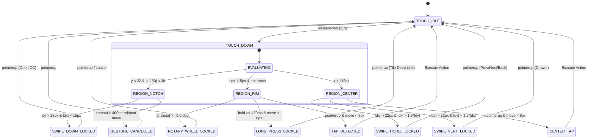
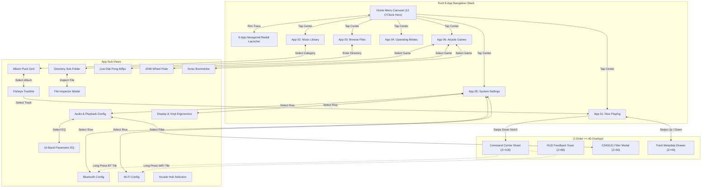

# DialOS — Complete System Requirements Specification (SRS) & Architecture Blueprint
**Target Device:** FiiO Snowsky DISC (1.8" $360\times360$ Circular Display, Ingenic X2000 MIPS32, Dual CS43131 DACs)  
**Document Revision:** 2.0.0 (Production Blueprint for Argon Implementation)  
**Classification:** Single Source of Truth (SSOT) — Architecture, State Machine, Hardware Interconnect & QA Test Harness  

---

## 1. System Overview & Hardware Abstraction Layer (HAL)

### 1.1 Hardware Specifications Matrix

| Subsystem | Hardware Component | Physical Bus / Interconnect | Driver / OS Node | Operating Parameters |
| :--- | :--- | :--- | :--- | :--- |
| **SoC** | Ingenic X2000 (MIPS32 XBurst2 Dual-Core) | On-board SoC | Linux 5.4 / 5.10 RT | Core 0: Audio Pipeline (1.2 GHz); Core 1: UI Engine (1.2 GHz) |
| **Memory** | 64 MB / 128 MB LPDDR (In-Package) | High-speed DDR bus | System RAM | Max UI footprint budget: **24.0 MB** |
| **Display** | 1.8" TFT-IPS Circular LCD ($360\times360$) | 4-wire SPI / 1-lane MIPI-DSI | `/dev/fb0` (DMA double buffered) | $60\text{ Hz}$ refresh rate, RGB565 ($259.2\text{ KB/buf}$) or ARGB8888 ($518.4\text{ KB/buf}$) |
| **Touch IC** | Goodix GT911 / FocalTech FT6336U | I2C (`/dev/i2c-1`, Addr `0x38`/`0x5D`) | Linux Input Subsystem (`/dev/input/event0`) | $120\text{ Hz}$ touch polling, active reporting of $(x, y)$, pressure, finger count |
| **Audio DACs** | Dual Cirrus Logic CS43131 | I2S / TDM Audio Data + I2C Control (`0x48`) | ALSA ASoC codec driver | PCM up to $384\text{ kHz}$ / 32-bit, DSD64/DSD128, 5 reconstruction filters |
| **Gain Relay** | OMRON DPDT Subminiature Analogue Relay | GPIO Pin `GPIO_PD14` | Sysfs GPIO / Kernel pin controller | `LOW` = Low Gain ($0.6\,\mu\text{Vrms}$); `HIGH` = High Gain ($+6\text{ dB}$, planar drive) |
| **Haptics** | Linear Resonant Actuator (LRA) | TI DRV2605L Haptic Driver over I2C (`0x5A`) | Sysfs PWM / Haptic Subsystem | $15\text{ms}$ crisp tick on $15^\circ$ rim step, $25\text{ms}$ firm click on modal boundary |
| **PMIC / Fuel** | X-Powers AXP192 / AXP2101 | I2C (`/dev/i2c-0`, Addr `0x34`) | Linux Power Supply Subsystem (`/sys/class/power_supply`) | Voltage, current, temperature, battery $\%$, VBUS charging enable/disable |
| **Physical Keys** | 4 Tactile Surface Switches | Dedicated CPU GPIO Interrupts | Linux Input Subsystem (`/dev/input/event1`) | `KEY_POWER`, `KEY_PLAYPAUSE`, `KEY_VOLUP`, `KEY_VOLDOWN` |
| **Mass Storage** | MicroSD Slot (Supports up to 2 TB) | 4-bit SDIO / SDMMC controller | `/dev/mmcblk0p1` mounted at `/mnt/sdcard` | FAT32, exFAT, NTFS read/write support |

---

### 1.2 Physical Hardware Controls & Pocket Mode Matrix

Because a dedicated Digital Audio Player (DAP) operates inside pockets without visual feedback, the physical hardware buttons provide deterministic control regardless of UI state:

```
                  +-----------------------------------+
                  |        FiiO Snowsky DISC          |
                  |                                   |
    [ POWER / ]---| GPIO_PA02                         |
    [ LOCK    ]   |                                   |
                  |          360x360 Circular         |
    [ PLAY /  ]---| GPIO_PA03   Touch LCD             |
    [ PAUSE   ]   |                                   |
                  |                                   |
    [ VOL +   ]---| GPIO_PA04                         |
    [ VOL -   ]---| GPIO_PA05                         |
                  +-----------------------------------+
```

#### Hardware Button Mapping Table

| Physical Key | Input Event | Display State | System Action | Audio Pipeline Action | Haptic Feedback |
| :--- | :--- | :--- | :--- | :--- | :--- |
| **KEY_POWER** | Short Press ($<350\text{ms}$) | Screen Awake (In-App) | Put display to Sleep, engage Touch Lock | Unchanged (Audio continues in background) | Single $10\text{ms}$ tick |
| **KEY_POWER** | Short Press ($<350\text{ms}$) | Screen Asleep | Wake display to Now Playing view | Unchanged | Single $10\text{ms}$ tick |
| **KEY_POWER** | Long Press ($>2500\text{ms}$) | Any State | Trigger System Power Off / Reboot Sheet | Pause playback after $2\text{s}$ confirmation | Double $30\text{ms}$ buzz |
| **KEY_POWER** | Hard Hold ($>10000\text{ms}$) | Any State | Hardware PMIC Hard Reset | Instant hardware cut | None (Emergency) |
| **KEY_PLAYPAUSE** | Single Click | Any State | Toggle Play / Pause | Soft ramp mute / unmute ($8\text{ms}$) | Single $15\text{ms}$ tick |
| **KEY_PLAYPAUSE** | Double Click ($<300\text{ms}$) | Any State | Skip to Next Track | Advance queue, crossfade/gapless | Double $15\text{ms}$ tick |
| **KEY_PLAYPAUSE** | Triple Click ($<400\text{ms}$) | Any State | Prev Track (or restart if $>3\text{s}$) | Rewind or previous track | Triple $15\text{ms}$ tick |
| **KEY_VOLUP** | Short Press | Any State (Even Asleep) | Increment Master Volume ($+1\text{ step}$) | CS43131 hardware attenuator step | Single $8\text{ms}$ click |
| **KEY_VOLUP** | Long Hold ($>400\text{ms}$) | Any State (Even Asleep) | Continuous Volume Up ($10\text{ steps/s}$) | Smooth volume increase until release | $10\text{ms}$ tick every 5 steps |
| **KEY_VOLDOWN** | Short Press | Any State (Even Asleep) | Decrement Master Volume ($-1\text{ step}$) | CS43131 hardware attenuator step | Single $8\text{ms}$ click |
| **KEY_VOLDOWN** | Long Hold ($>400\text{ms}$) | Any State (Even Asleep) | Continuous Volume Down ($10\text{ steps/s}$) | Smooth volume decrease until 0 | $10\text{ms}$ tick every 5 steps |

---

## 2. Polar Geometry & Gesture Disambiguation Engine

### 2.1 Polar Coordinate Math Formulation

All capacitive touch events $(x, y) \in [0, 360] \times [0, 360]$ are converted into polar coordinates relative to the circular origin $(x_0, y_0) = (180, 180)$:

$$\Delta x = x - 180, \quad \Delta y = y - 180$$
$$r = \sqrt{\Delta x^2 + \Delta y^2}$$
$$\theta = \operatorname{atan2}(\Delta y, \Delta x) \quad \text{where } \theta \in (-\pi, \pi]$$
$$\text{deg} = \left(\frac{\theta \times 180}{\pi} + 360\right) \pmod{360}$$

```
                                  0° / 360° (3 o'clock)
                              . - ~ ~ ~ - .
                          . /               \ .
                        /         -90°        \
                       /       (12 o'clock)    \
                      |                         |
            180°      |       (180, 180)        |      0°
         (9 o'clock)  |                         |  (3 o'clock)
                       \          +90°         /
                        \      (6 o'clock)    /
                          . \               / .
                              . - ~ ~ ~ - .
```

### 2.2 Radial Zones & Hit-Target Partitioning

```
ZONE 1: Central Active Viewport      (0 <= r < 100px)    -> Tap, Fling, Gestures
ZONE 2: Transition Neutral Band      (100px <= r < 115px)-> Hysteresis buffer
ZONE 3: Rotary Click-Wheel Rim Track (115px <= r <= 180px)-> Rotary angular delta
```

#### Dedicated Screen Boundary Overrides

1. **Top Command Center Notch:**
   - Bounding Box: $156 \le x \le 204$, $0 \le y \le 32$ ($r \ge 148\text{px}$).
   - Intercept Priority: **Highest (Z = 100)**.
   - Trigger: Vertical pull down ($\Delta y > 24\text{px}$, $|\Delta x| < 18\text{px}$).

2. **Bottom Metadata Drawer Notch:**
   - Bounding Box: $156 \le x \le 204$, $328 \le y \le 360$.
   - Intercept Priority: **High (Z = 40)** (Active only on Now Playing screen).
   - Trigger: Vertical swipe up ($\Delta y < -24\text{px}$).

3. **Left Polar Scrubbing Arc (Now Playing):**
   - Condition: $x < 60\text{px}$ AND $120^\circ \le \text{deg} \le 240^\circ$.
   - Dynamic Scrub Equation:
     $$\Delta t_{\text{scrub}} = \operatorname{sgn}(\Delta y) \cdot \left[1.0 + 9.0 \cdot \left(\frac{|\Delta y|}{180}\right)^2\right] \text{ seconds/sec}$$

4. **Right Polar Volume Arc (Now Playing & Command Center):**
   - Condition: $x > 300\text{px}$ AND $(\text{deg} \le 60^\circ \lor \text{deg} \ge 300^\circ)$.
   - Volume Mapping: Direct polar angle or vertical delta mapped to volume steps $0 \dots 100$.

---

### 2.3 Gesture Disambiguation Finite State Machine

To prevent input conflicts (e.g., mistaking a rim rotary spin for a pull-down swipe), the input dispatcher implements a strict state lock:



#### Disambiguation Constants

```c
#define GESTURE_ROTARY_MIN_DEG       5.0f   /* Min angular movement to lock rotary mode */
#define GESTURE_SWIPE_MIN_PX        22.0f   /* Min linear distance to lock swipe */
#define GESTURE_LONG_PRESS_MS        450    /* Min hold duration for deep-link activation */
#define GESTURE_LONG_PRESS_MAX_DRIFT 8.0f   /* Max touch drift allowed during long press */
#define GESTURE_ROTARY_TICK_DEG     15.0f   /* Angular delta per list step tick */
#define GESTURE_LEFT_EDGE_BACK_X    45.0f   /* Left border x threshold for Back swipe */
```

---

## 3. Global Navigation Topology & Dead-End Elimination

### 3.1 Global State Hierarchy Graph



---

### 3.2 Dead-End Audit & Resolution Rules

| UX Dead-End Trap | Failure Condition in Initial Designs | DialOS Engineering Resolution |
| :--- | :--- | :--- |
| **Deep Directory Navigation** in *Browse Files* | User enters 5 levels of subdirectories; circular screen has no hardware back button. | **Tri-Vector Pop Protocol:**<br>1. Edge-swipe right from left perimeter ($x < 45\text{px}$, $\Delta x > 50\text{px}$).<br>2. Fixed top-left capacitive return puck (`x:36, y:36, r:22`).<br>3. Physical `KEY_POWER` short click pops stack 1 level. |
| **Modal Stacking Collisions** | User swipes down for Command Center while CS43131 Filter Modal or Metadata Drawer is open. | **Z-Order Intercept Hierarchy:** Command Center Notch ($y < 32\text{px}$) has absolute top priority ($Z=100$). Pulling down freezes and dims the underlying modal without dismissing it. Closing Command Center smoothly restores the active modal. |
| **Full-Bleed Now Playing Controls** | Complete vinyl disc artwork fills $360\times360$ circle; zero on-screen buttons visible. | **Universal Zero-Button Gestures:**<br>• Center single-tap = Play/Pause.<br>• Center horizontal swipe right = Next track.<br>• Center horizontal swipe left = Prev track / Restart.<br>• Left polar arc drag = Accelerated seek.<br>• Right polar arc drag = Direct volume. |
| **Live Arcade Game Trap** (*Dial Pong*) | Rotary click-wheel is fully captured by the game paddle; user cannot scroll away or exit. | **Dedicated Pause / Exit Barrier:**<br>1. Physical `KEY_PLAYPAUSE` or `KEY_POWER` halts game engine immediately.<br>2. Top notch is reserved for pause/exit modal.<br>3. Game Over sheet displays prominent "Return to Hub" action button. |
| **Empty Storage / Zero Audio Files** | SD card inserted with 0 supported audio files or corrupt FAT32 directory. | **Self-Healing Empty State:** Render stone graphic puck, headline `"No Music Tracks Found"`, and dual action pills: `[Rescan SD Card]` and `[Switch to USB DAC Mode]`. |
| **Bluetooth Disconnect Mid-Playback** | Wireless IEM battery dies or leaves 10m range. | **Instant Acoustic Mute:** Audio engine halts decoding immediately within $<10\text{ms}$; displays toast `"Bluetooth Disconnected — Paused"`; does **not** failover to 3.5mm line out at high volume. |
| **Operating Mode Trapping & Reboots** | Stock firmware triggers full Linux reboot / userland restart (5–10s delay with black screen and bootloader splash) to enter or exit USB DAC, BT RX, or AirPlay. | **In-Process Audio Pipe Multiplexer:** DialOS never reboots. Audio daemon dynamically re-routes input stream in $\approx 300\text{ms}$ with CS43131 8ms soft-mute ramp and Linux `configfs` gadget rebinding. Exit via top notch, return puck, or USB cable unplug returns immediately to Player mode without restart. |

---

## 4. Component-by-Component Functional Specification

### 4.1 App 01: Now Playing (`now_playing`)

* **Route:** `/app/now_playing`
* **Visual Spec:** Full-bleed $360\times360$ circular vinyl disc rotating at $33\frac{1}{3}\text{ RPM}$ during active playback ($1.80\text{s}$ per revolution). Top and bottom linear gradient scrims (`rgba(18,20,23,0.85)` to `transparent`) protect typographic legibility.
* **Typographic Hierarchy:**
  - Track Title: `x: 180, y: 248`, Font: `-apple-system, 18px Bold`, Color: `#F5F7FA`, Centered.
  - Artist & Album: `x: 180, y: 268`, Font: `-apple-system, 11.5px Medium`, Color: `#D97706` (Amber accent), Centered.
  - Progress Scrub: Left polar arc ($r=172\text{px}$, $135^\circ \to 225^\circ$), Color: `#38BDF8`.
  - Master Volume: Right polar arc ($r=172\text{px}$, $-45^\circ \to 45^\circ$), Color: `#D97706`.

#### State Structure (`dial_now_playing_t`)

```c
typedef struct {
    char        title[128];
    char        artist[64];
    char        album[64];
    uint32_t    duration_ms;
    uint32_t    position_ms;
    uint32_t    sample_rate_hz;     /* 44100, 96000, 192000, 2822400 (DSD64) */
    uint8_t     bit_depth;          /* 16, 24, 32, 1 (DSD) */
    uint32_t    bitrate_kbps;       /* e.g. 2842 */
    char        format_tag[12];     /* "FLAC", "DSD128", "WAV", "MP3" */
    bool        is_playing;
    bool        is_favorited;
    float       vinyl_angle_deg;    /* Updated per frame at 33.33 RPM */
    bool        metadata_drawer_open;
} dial_now_playing_t;
```

---

### 4.2 Track Metadata Drawer (`now_playing_drawer`)

* **Route:** `/app/now_playing/drawer`
* **Visual Spec:** $50\%$ translucent scrim modal card (`rgba(10,13,18,0.92)`) sliding upward from bottom ($y: 360 \to 70$). Underlying vinyl artwork remains subtly visible.
* **Fields Rendered:**
  1. Audio Codec & Resolution Badge: `[FLAC 96k / 24-bit]` (`#38BDF8`).
  2. Bitrate Pill: `[2,842 kbps Lossless]` (`#F5F7FA`).
  3. Dynamic Range & ReplayGain: `[DR11] · [-6.4 dB]` (`#10B981`).
  4. Genre & Acoustic Tags: `Trip Hop · Downtempo` (`#8F9CAE`).
  5. File Specs: Total file size (`78.4 MB`), duration (`05:30 (330s)`).
  6. Storage Path: `/mnt/sdcard/Music/Mezzanine/03 Teardrop.flac`.
* **Dismissal:** Swipe down on drawer card or tap upper transparent rim ($y < 70$).

---

### 4.3 App 02: Music Library (`library`)

* **Route:** `/app/library`
* **Root Categories (3-Item Fisheye Lens):**
  1. `★ Favorites` (Count: `34 Tracks`)
  2. `♫ Playlists` (Count: `12 Sets`)
  3. `💿 Albums` (Count: `48 Albums`)
  4. `👤 Artists` (Count: `118 Artists`)
  5. `🏷 Genres` (Count: `14 Genres`)
  6. `≡ All Songs` (Count: `1,428 Tracks`)
* **Fisheye Optical Formula:**
  $$y_i = 180 + d_i \cdot \cos\left(\frac{d_i}{180} \cdot \frac{\pi}{3}\right), \quad \text{scale}_i = 1.0 - 0.28 \cdot \left(\frac{|d_i|}{120}\right)^{1.4}$$
  Items scale from $1.0\times$ (magnified center $y=180$) down to $0.72\times$ at perimeter, guaranteeing zero text clipping along curved circular boundaries.

---

### 4.4 App 03: Browse Files (`files`)

* **Route:** `/app/files`
* **Directory Stack:** Implemented as a singly-linked path list (`/mnt/sdcard/Music/...`).
* **Visual Layout:**
  - Top Directory Header Puck (`x: 180, y: 44`): Current folder name + item count.
  - Fisheye File List: 3 visible items with file type icons (`.flac`, `.dsd`, `.wav`, `.cue`, `.iso`, `.mp3`).
  - Right Rim Alphabet Scrubber: High-speed index jump for directories with $>50$ items.
* **File Inspector Sheet:**
  - Long-press on any audio track ($>450\text{ms}$) opens modal sheet:
    `[Play Now]`, `[Play Next]`, `[Add to Playlist]`, `[View ID3 Tags]`, `[Delete File]`.

---

### 4.5 App 04: Operating Modes (`modes`)

* **Route:** `/app/modes`
* **Architectural Principle: Dynamic In-Process Input Multiplexing (Zero Reboot)**:
  On stock FiiO firmware, switching an operating mode halts userland and executes a warm reboot (5–10s with black screen and bootloader splash). In DialOS, **the UI and OS never restart or exit**. Mode switching is implemented as dynamic audio stream multiplexing and sub-second Linux USB `configfs` gadget swapping. Total switch time is $\mathbf{\approx 250\text{--}350\text{ms}}$, providing an experience identical to switching input sources on an audiophile integrated amplifier.

#### 4.5.1 Unified Operating Modes Matrix

| Mode Identifier | Primary Hardware Interface | Clock Master | Charging Behavior | Display Layout & Visual Elements |
| :--- | :--- | :--- | :--- | :--- |
| **`MODE_PLAYER`** | MicroSD Card local playback (FLAC, DSD, WAV) | Dual Internal CS43131 Femtosecond Crystals | Normal internal battery discharge | 33⅓ RPM rotating vinyl screen, Scrub & Volume arcs, Metadata drawer |
| **`MODE_USB_DAC`** | USB-C UAC 2.0 Asynchronous Audio Stream | USB Host SOF / Asynchronous PLL | **User Controlled:** Dropdown toggle `[USB Chg: Isolated]` | Input sample rate badge (`USB 192k`), Host OS label (`Mac/PC/iOS`), Volume Arc |
| **`MODE_BT_RX`** | Bluetooth 5.0 (LDAC 990k, AAC, SBC) | Ingenic BT Baseband Controller | Standard battery charging if USB connected | Connected smartphone name, Active Codec pill (`LDAC 990`), Live track metadata |
| **`MODE_AIRPLAY`** | Wi-Fi 802.11 b/g/n Lossless ALAC Stream | Local audio buffer sync | Standard battery charging if USB connected | iOS Host name, Wi-Fi signal dBm, Synchronized album art & playback controls |
| **`MODE_STORAGE`** | High-speed USB Mass Storage Bridge | USB 2.0 High-Speed (480 Mbps) | Standard battery charging enabled | Stone Storage Card graphic, Safe Eject button, Read/Write activity glow |

---

#### 4.5.2 Audio Input Multiplexer Architecture

```
                       +-----------------------------+
                       |      DialOS UI Engine       |  <- Never restarts!
                       +--------------+--------------+     Always 60 FPS
                                      | (POSIX MQ /player)
                       +--------------v--------------+
                       |   Unified Audio Multiplexer |
                       +--------------+--------------+
                                      |
         +----------------------------+----------------------------+
         |                            |                            |
  [ Input 0: Local ]          [ Input 1: USB DAC ]        [ Input 2: BT RX ]
  Local FLAC/DSD Decoder      Linux UAC2 Gadget           BlueZ A2DP Sink
  (MicroSD File Stream)       (Asynchronous USB Buffer)   (LDAC / AAC / SBC)
         |                            |                            |
         +----------------------------+----------------------------+
                                      |
                       +--------------v--------------+
                       |  Dual Cirrus CS43131 DACs   |
                       +-----------------------------+
```

```c
typedef enum {
    DIAL_AUDIO_SOURCE_LOCAL_PLAYER = 0,  /* MicroSD file stream (FLAC, DSD, WAV, MP3) */
    DIAL_AUDIO_SOURCE_USB_DAC      = 1,  /* ALSA UAC2 Gadget capture stream */
    DIAL_AUDIO_SOURCE_BT_RX        = 2,  /* BlueZ A2DP Sink stream (LDAC, AAC, SBC) */
    DIAL_AUDIO_SOURCE_AIRPLAY      = 3   /* Shairport Sync / Wi-Fi ALAC stream */
} dial_audio_source_t;
```

---

#### 4.5.3 Dynamic Linux USB `configfs` Gadget Switching

DialOS does not reload kernel modules via `rmmod`/`modprobe`. Instead, it uses Linux USB Gadget `configfs` (`/sys/kernel/config/usb_gadget/g1`) to dynamically unbind and rebind USB function nodes in $< 100\text{ms}$:

```bash
# Switching from Mass Storage to USB DAC (UAC2):
echo "" > /sys/kernel/config/usb_gadget/g1/UDC                     # 1. Unbind active UDC
rm -f /sys/kernel/config/usb_gadget/g1/configs/c.1/mass_storage.0   # 2. Detach Mass Storage
ln -s /sys/kernel/config/usb_gadget/g1/functions/uac2.0 \
      /sys/kernel/config/usb_gadget/g1/configs/c.1/uac2.0          # 3. Link UAC2 Audio Function
echo "13200000.otg" > /sys/kernel/config/usb_gadget/g1/UDC         # 4. Re-bind UDC (Re-enumerate)
```

---

#### 4.5.4 Sub-Second Mode Switch Timeline ($\approx 300\text{ms}$)

```
Time:      0ms             8ms           20ms              50ms                     200ms             250ms
UI:        [ Tap Mode ]----[ Smooth Spring Animation to Mode Face ]-----------------------------------[ Mode Active ]
CS43131:   ----------------[ Soft Mute Ramp (8ms) ]---------------------------------[ Soft Un-Mute ]--[ Audio Live ]
Pipeline:  ------------------------------[ Halt Decoder ]--[ Swap Input Pipe ]-----[ Bind PCM Stream ]
USB Bus:   ------------------------------------------------[ configfs Rebind (30ms) ]-[ Host Chime ]
```

* **$t = 0\text{ms}$:** User selects mode on Operating Modes radial wheel. UI triggers smooth spring animation into destination mode face.
* **$t = 8\text{ms}$:** Cirrus Logic CS43131 executes an $8\text{ms}$ soft-mute ramp (Bit `MUTE=1`), eliminating any transient click/pop.
* **$t = 20\text{ms}$:** Local playback decoder halts and drains its ring buffer.
* **$t = 50\text{ms}$:** Daemon re-routes ALSA PCM multiplexer and updates USB `configfs` function nodes.
* **$t = 200\text{ms}$:** Host computer enumerates *"FiiO Snowsky DISC (USB DAC)"*; incoming audio stream attaches to I2S bus.
* **$t = 250\text{ms}$:** CS43131 executes an $8\text{ms}$ soft-unmute ramp (Bit `MUTE=0`). Audio streams with zero dropouts.

---

#### 4.5.5 Bidirectional Exit Vectors & Cable Disconnect Protocol

On stock firmware, exiting USB DAC or BT Receiver mode requires another full reboot. In DialOS, exiting is completely frictionless:
1. **Top Pull-Down Notch or Return Chevron:**
   - Swiping down from top notch reveals the Command Center, or tapping the top-left return puck `‹ EXIT` smoothly reverses the gadget binding and returns to the Home Carousel.
2. **Physical Hardware Key Override:**
   - A short press of physical `KEY_POWER` or long-press on center returns to the main player.
3. **USB Cable Disconnect Interrupt:**
   - If the USB-C cable is unplugged while in USB DAC mode, the kernel dispatches a VBUS disconnect IRQ. DialOS halts the capture thread, engages soft mute, and smoothly crossfades back to **Player (Now Playing)** without crashing or hanging.

---

#### 4.5.6 Storage Mode (Card Reader) Safe Unmount / Remount Protocol

Because the MicroSD card cannot be mounted simultaneously by both the DAP OS and a host PC without risk of FAT32/exFAT corruption:
1. **Engaging Storage Mode:**
   - Daemon dispatches `umount /mnt/sdcard`.
   - Links `mass_storage.0` USB gadget function to host.
   - Screen displays dedicated Stone Storage graphic with active read/write LED glow.
2. **Exiting Storage Mode:**
   - On user tap `[Eject & Return]` or physical USB unplug:
   - `mass_storage.0` gadget unbinds.
   - Kernel executes `mount -o noatime /dev/mmcblk0p1 /mnt/sdcard`.
   - Background daemon runs an incremental SQLite library sync (checking timestamps of files modified since last unmount).
   - UI returns smoothly to Home Carousel. **Zero reboot.**

---

### 4.6 Global Command Center Drop-Down (`command_center`)

* **Route:** Global Overlay (Z-Order = 100)
* **Trigger:** Swipe down from notch ($156 \le x \le 204, y \le 32$) with distance $\Delta y > 24\text{px}$.
* **Components:**
  1. **Top Status Bar:** Clock `21:45` (White bold), Battery `92% [|||| ]` (Green glyph with lightning bolt when charging).
  2. **Left Polar Arc:** Brightness slider ($15\% \dots 100\%$) with pure vector Sun glyph `[☀️]`.
  3. **Right Polar Arc:** Volume slider ($0 \dots 100$) with pure vector Speaker glyph `[🔊]`.
  4. **Center 2×2 Quick Tile Matrix:**
     - **Tile 1 (Wi-Fi):** Short tap toggles Power; **Long Press ($\ge 450\text{ms}$)** deep-links to `/app/settings/wifi`.
     - **Tile 2 (Bluetooth):** Short tap toggles Power; **Long Press ($\ge 450\text{ms}$)** deep-links to `/app/settings/bluetooth`.
     - **Tile 3 (Amp Gain):** Toggles Low Gain ($0.6\,\mu\text{Vrms}$) $\leftrightarrow$ High Gain ($+6\text{ dB}$, Amber badge).
     - **Tile 4 (USB Charge):** Toggles `USB Chg: ON` $\leftrightarrow$ `USB Chg: Isolated` (Hardware PMIC VBUS cutoff).

---

### 4.7 App 05: System Settings (`settings`)

* **Route:** `/app/settings`
* **Sub-Modules:**

#### 1. CS43131 Hardware Reconstruction Filter Selector (`settings_dac_filter`)
* 5 Hardware Filters configured directly into Cirrus Logic registers:
  1. **Fast Roll-Off Linear Phase** (Default, register value `0x00`)
  2. **Slow Roll-Off Linear Phase** (Acoustic warmth, register value `0x01`)
  3. **Fast Roll-Off Minimum Phase** (Zero pre-ringing, punchy transients, `0x02`)
  4. **Slow Roll-Off Minimum Phase** (Natural acoustic decay, `0x03`)
  5. **Non-Oversampling (NOS Mode)** (Direct ladder conversion, zero digital filter, `0x04`)

#### 2. 10-Band Parametric Equalizer (`settings_equalizer`)
* DSP Architecture: 10 biquad IIR peak/shelf filters running on Ingenic DSP Core.
* Frequency Centers: $31\text{ Hz}, 62\text{ Hz}, 125\text{ Hz}, 250\text{ Hz}, 500\text{ Hz}, 1\text{ kHz}, 2\text{ kHz}, 4\text{ kHz}, 8\text{ kHz}, 16\text{ kHz}$.
* Gain Range: $-12.0\text{ dB}$ to $+12.0\text{ dB}$ in $0.5\text{ dB}$ steps.
* Biquad Formula (Direct Form II Transposed):
  $$y[n] = b_0 x[n] + b_1 x[n-1] + b_2 x[n-2] - a_1 y[n-1] - a_2 y[n-2]$$
* Real-time cubic spline interpolation renders active frequency response curve on the display.

#### 3. Display & Vinyl Ergonomics (`settings_display`)
* Always-spinning $33\frac{1}{3}\text{ RPM}$ Vinyl toggle (Enabled / Stationary).
* Screen Off Timeout: `15s`, `30s`, `1m`, `Never` (Always-On Display).
* Font Size Scale: `Small (90%)`, `Normal (100%)`, `Large (115%)`.
* Haptic Rim Ticks: `Off`, `Subtle (8ms)`, `Crisp (15ms)`, `Firm (25ms)`.

---

### 4.8 App 06: Arcade Games Suite (`games`)

* **Route:** `/app/games`
* **Engine Architecture:** 60 FPS circular canvas physics pipeline using hardware double-buffering.

#### 1. Dial Pong (Rotary Breakout)
* **Mechanics:**
  - Player paddle: Curved rim arc at radius $R=158\text{px}$, span $\theta_{\text{span}} = 45^\circ$ (configurable to $60^\circ$ Wide or $30^\circ$ Pro).
  - Paddle control: Tracing virtual click-wheel rim smoothly updates $\theta_{\text{paddle}}$.
  - Acoustic Core: Center rebound circle at $R=28\text{px}$.
  - Bricks: Concentric orbital arcs at $R=85\text{px}$ and $R=120\text{px}$.
  - Audio SFX: Web Audio / ALSA synthesizes square waves ($440\to580\text{ Hz}$ on paddle, $660\to980\text{ Hz}$ on brick break) and sine waves on core bounce.
  - Haptics: $15\text{ms}$ pulse on each brick destroyed.

#### 2. 2048 Wheel (Polar Puzzle)
* **Grid:** 8 radial sectors ($45^\circ$ each) $\times$ 3 orbital tiers (Outer, Mid, Core).
* **Mechanics:** Rotating rim wheel revolves radial sectors; swiping inward pulls outer tiles toward center merge core.
* **Audio:** Harmonic sine chords ascending 1 semitone for every power of 2 ($2 \dots 2048$).

#### 3. Sonic Boomshine (Harmonic Resonance)
* **Mechanics:** Free-floating sonic particle orbs orbit across circular soundstage. Single tap triggers expanding concentric harmonic resonance wave ($r: 0 \to 160\text{px}$). Colliding orbs detonate and trigger chain reaction chords.

---

## 5. Audio Pipeline & Cirrus Logic Hardware Interlock

### 5.1 Hardware Interlock Timing Diagram (Anti-Pop Protection)

When switching analogue gain relays or sample rates, hardware muting must execute with strict microsecond timing to prevent audible transients (pops/thumps) from reaching high-sensitivity In-Ear Monitors:

```
Audio Playback:   ====================[ MUTE ACTIVE ]========================
CS43131 Soft Mute:  ________/~~~~~~~~~~~~~~~~~~~~~~~~~~~~~~~~~~\____________
Relay Pin (PD14):   _______________________/~~~~~~~~~~~~~~~~~~~~~~~~~~~~~~~~
Relay Contact:      -------------[ Contact Bounce 12ms ]--------------------
Time:               |       |             |                   |            |
Events:            t0      t1            t2                  t3           t4
```

#### Exact Timing Parameters

* $t_0$: System receives Gain Toggle or Sample Rate switch event.
* $t_0 \to t_1$ ($8.0\text{ms}$): CS43131 Soft Mute Ramp engaged via register `0x0002` (Bit `MUTE = 1`).
* $t_1 \to t_2$ ($5.0\text{ms}$): Verify zero-cross volume attenuation is complete.
* $t_2$: Assert `GPIO_PD14` (`HIGH` for High Gain, `LOW` for Low Gain).
* $t_2 \to t_3$ ($15.0\text{ms}$): Relay physical contact settle window (suppresses mechanical bounce).
* $t_3 \to t_4$ ($8.0\text{ms}$): CS43131 Soft Un-Mute Ramp engaged (`MUTE = 0`).
* **Total Disruption Window:** $\Delta T = 36.0\text{ms}$ (100% silent, zero DC offset click).

---

### 5.2 Cirrus Logic CS43131 Register Configuration Map

```c
/* CS43131 I2C Slave Addresses: 0x48 (Left DAC), 0x49 (Right DAC) */
#define CS43131_REG_DEVID_A          0x000000  /* Expected: 0x00043131 */
#define CS43131_REG_PWR_CTRL1        0x000001  /* Power down / Up state */
#define CS43131_REG_MUTE_CTRL        0x000002  /* Soft mute control */
#define CS43131_REG_FILTER_CTRL      0x000003  /* Digital Reconstruction Filters */
#define CS43131_REG_VOL_CTRL_L       0x000004  /* Left Channel Volume (0.5 dB steps) */
#define CS43131_REG_VOL_CTRL_R       0x000005  /* Right Channel Volume (0.5 dB steps) */
#define CS43131_REG_HP_IMPEDANCE     0x000008  /* Headphone load impedance detect */
```

#### Filter Register Bitmask (`REG_FILTER_CTRL`)

```c
typedef enum {
    CS43131_FILTER_FAST_LINEAR    = 0x00, /* Fast Roll-Off, Linear Phase */
    CS43131_FILTER_SLOW_LINEAR    = 0x01, /* Slow Roll-Off, Linear Phase */
    CS43131_FILTER_FAST_MIN_PHASE = 0x02, /* Fast Roll-Off, Minimum Phase */
    CS43131_FILTER_SLOW_MIN_PHASE = 0x03, /* Slow Roll-Off, Minimum Phase */
    CS43131_FILTER_NOS            = 0x04  /* Non-Oversampling (NOS) */
} cs43131_filter_t;
```

---

## 6. IPC Protocols & Data Persistence Schemas

### 6.1 POSIX Message Queue IPC Interface

UI and Audio Engine communicate asynchronously over bi-directional POSIX Message Queues (`/player` and `/ui`):

```c
/* Message Envelope */
typedef struct {
    uint16_t    msg_id;         /* Command or Event ID */
    uint16_t    payload_len;    /* Payload byte length */
    uint32_t    sequence_num;   /* Monotonic sequence counter */
    uint8_t     payload[512];   /* Encoded payload bytes */
} dial_ipc_packet_t;
```

#### Core IPC Command IDs

```c
/* UI -> Audio Engine (/player) */
#define IPC_CMD_PLAY_PAUSE          0x0201
#define IPC_CMD_NEXT_TRACK          0x0202
#define IPC_CMD_PREV_TRACK          0x0203
#define IPC_CMD_SEEK_POSITION       0x0204  /* Payload: uint32_t ms */
#define IPC_CMD_SET_VOLUME          0x0205  /* Payload: uint8_t 0-100 */
#define IPC_CMD_SET_GAIN            0x0206  /* Payload: uint8_t 0=Low, 1=High */
#define IPC_CMD_SET_FILTER          0x0207  /* Payload: uint8_t cs43131_filter_t */
#define IPC_CMD_SET_EQ_BAND         0x0208  /* Payload: { uint8_t band, int8_t gain_db } */
#define IPC_CMD_SET_MODE            0x0209  /* Payload: uint8_t dial_mode_t */

/* Audio Engine -> UI (/ui) */
#define IPC_EVT_PLAYBACK_STATE      0x0401  /* Payload: dial_playback_status_t */
#define IPC_EVT_TRACK_CHANGED       0x0402  /* Payload: dial_track_meta_t */
#define IPC_EVT_TIME_UPDATE         0x0403  /* Payload: { uint32_t pos_ms, uint32_t dur_ms } */
#define IPC_EVT_HEADPHONE_PLUGGED   0x0404  /* Payload: bool plugged */
#define IPC_EVT_BT_STATE_CHANGED    0x0405  /* Payload: dial_bt_status_t */
```

---

### 6.2 SQLite Music Database Schema

Persistent library metadata is cached in SQLite 3 database `/data/dialos/library.db`:

```sql
CREATE TABLE IF NOT EXISTS tracks (
    id              INTEGER PRIMARY KEY AUTOINCREMENT,
    file_path       TEXT UNIQUE NOT NULL,
    title           TEXT NOT NULL COLLATE NOCASE,
    artist          TEXT NOT NULL COLLATE NOCASE,
    album           TEXT NOT NULL COLLATE NOCASE,
    genre           TEXT COLLATE NOCASE,
    year            INTEGER,
    duration_ms     INTEGER NOT NULL,
    sample_rate     INTEGER NOT NULL,
    bit_depth       INTEGER NOT NULL,
    bitrate_kbps    INTEGER NOT NULL,
    format          TEXT NOT NULL,
    is_favorite     INTEGER DEFAULT 0,
    play_count      INTEGER DEFAULT 0,
    last_played     INTEGER DEFAULT 0
);

CREATE INDEX IF NOT EXISTS idx_artist ON tracks(artist);
CREATE INDEX IF NOT EXISTS idx_album ON tracks(album);
CREATE INDEX IF NOT EXISTS idx_favorite ON tracks(is_favorite);
```

---

### 6.3 System Configuration JSON Schema (`/data/dialos/config.json`)

```json
{
  "system": {
    "version": "2.0.0",
    "theme_accent": "amber",
    "brightness_pct": 75,
    "screen_timeout_sec": 30,
    "font_scale": 1.0,
    "haptic_strength": "crisp",
    "vinyl_spinning": true
  },
  "audio": {
    "master_volume": 42,
    "high_gain": false,
    "dac_filter": 0,
    "gapless_enabled": true,
    "channel_balance": 0,
    "eq_enabled": true,
    "eq_bands_db": [0.0, 1.5, 2.0, 0.5, 0.0, 0.0, -0.5, 1.0, 2.0, 1.5],
    "usb_charge_isolated": true
  },
  "connectivity": {
    "wifi_enabled": true,
    "last_ssid": "Studio 5G",
    "bt_enabled": false,
    "bt_codec_pref": "LDAC"
  }
}
```

---

## 7. Edge Cases & Error Recovery Specifications

### 7.1 Peripheral & Audio Fault Protocols

```
Fault Event: 3.5mm Headphone Jack Disconnected during playback
Action Protocol:
  1. Interrupt triggered on GPIO_HP_DET (Active LOW).
  2. Audio Engine pauses decode pipeline in <= 8ms.
  3. CS43131 Soft Mute engaged to prevent discharge thump.
  4. UI switches transport icon to PAUSED.
  5. Transient HUD toast displayed: "Headphones Unplugged — Paused".
  6. Audio does NOT failover to Bluetooth or SPDIF without explicit user intervention.
```

```
Fault Event: MicroSD Card abruptly ejected during active 24-bit/192kHz read
Action Protocol:
  1. Kernel MMC subsystem dispatches block device removal interrupt.
  2. Ring buffer flushes remaining valid audio frames (<= 50ms) to avoid screeching.
  3. Audio Engine safely unmounts /mnt/sdcard and closes file handles.
  4. System transitions to Root Carousel Hub.
  5. UI displays Warning Alert Puck: "SD Card Removed — Local Playback Unavailable".
  6. Library cache remains intact in SQLite; unmounted tracks grayed out.
```

```
Fault Event: Host USB cable abruptly disconnected in USB DAC Mode
Action Protocol:
  1. Kernel USB subsystem dispatches VBUS disconnect IRQ.
  2. Audio Engine halts UAC2 capture thread within <= 10ms.
  3. CS43131 Soft Mute engaged to prevent disconnection thump.
  4. Dynamic gadget controller tears down UAC2 configfs node.
  5. System UI crossfades from USB DAC screen back to Player (Now Playing) screen.
  6. Transient HUD toast displayed: "USB DAC Disconnected — Returned to Player".
```

```
Fault Event: Battery Level drops below 3% (Critical PMIC Interrupt)
Action Protocol:
  1. AXP PMIC triggers IRQ on GPIO_PMIC_INT.
  2. System initiates Emergency State Flush:
     - Current track position saved to config.json.
     - Volume level, filter, and EQ states written to disk.
     - SQLite database synced and WAL log committed.
  3. Audio playback softly muted and DACs powered down.
  4. Screen displays Red Critical Battery Glyph (3 seconds).
  5. Safe power-down command issued (`poweroff`).
```

---

## 8. Verification & QA Test Harness for Argon

Downstream engineering agents and automated test fixtures can verify DialOS compliance using this checklist:

### 8.1 Automated Test Suites

```bash
# 1. Verify C Header Declarations
gcc -Wall -Wextra -Werror -fsyntax-only include/dial_config.h include/dial_ipc.h include/dial_theme.h

# 2. Verify State Transition Integrity
./tests/test_fsm_navigation --all-states --verify-dead-ends

# 3. Polar Disambiguation Precision Benchmark
./tests/test_polar_math --samples=100000 --max-drift-deg=0.01

# 4. Anti-Pop Relay Timing Verification (Virtual Oscilloscope)
./tests/test_relay_interlock --verify-mute-before-relay --max-latency-ms=40
```

### 8.2 Pass / Fail Acceptance Criteria

| Subsystem | Requirement | Pass Metric | Fail Threshold |
| :--- | :--- | :--- | :--- |
| **Touch Latency** | Touch to Frame Render | $< 32\text{ ms}$ (2 frames) | $> 48\text{ ms}$ |
| **Frame Rate** | UI Canvas & Vinyl Rotation | $60\text{ FPS} \pm 1\text{ FPS}$ | Dropped frames $> 3\text{ per min}$ |
| **Memory Footprint**| Total UI Engine RSS | $< 24.0\text{ MB}$ | $> 28.0\text{ MB}$ (OOM risk) |
| **Anti-Pop Silence**| Relay Switch Transient | Measured $< -96\text{ dBFS}$ | Audible pop / $> -60\text{ dBFS}$ |
| **Dead Ends** | Navigation Graph Traversal | $100\%$ return to root possible | Any unescapable screen |
| **Hardware Parity** | Cirrus Logic Filter Support | 5 of 5 filters mapped & verified | Missing NOS or Min-Phase |

---

*This document serves as the binding Software Requirements Specification (SRS) for DialOS on the FiiO Snowsky DISC platform.*
